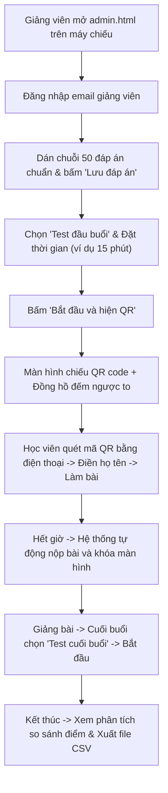

# HƯỚNG DẪN TRIỂN KHAI VÀ SỬ DỤNG HỆ THỐNG THI TRẮC NGHIỆM REALTIME

Chào mừng Thiếu Chủ đến với bộ tài liệu hướng dẫn toàn diện hệ thống web thi trắc nghiệm trực tuyến (sao chép nguyên bản từ repository `atbx-test`). Hệ thống được thiết kế tối ưu cho các lớp tập huấn, giảng dạy đại học, thi kiểm tra kiến thức trước và sau buổi học (Pre-test & Post-test).

---

## MỤC LỤC
1. [Kiến trúc & Tính năng nổi bật của hệ thống](#1-kiến-trúc--tính-năng-nổi-bật)
2. [Cấu trúc thư mục mã nguồn](#2-cấu-trúc-thư-mục-mã-nguồn)
3. [Chuỗi 50 đáp án chuẩn (Answer Key)](#3-chuỗi-50-đáp-án-chuẩn-answer-key)
4. [Hướng dẫn cài đặt Firebase từ A đến Z (Miễn phí 100%)](#4-hướng-dẫn-cài-đặt-firebase)
   - [Bước 4.1: Tạo Firebase Project](#bước-41-tạo-firebase-project)
   - [Bước 4.2: Cấu hình Authentication (Anonymous + Email/Password)](#bước-42-cấu-hình-authentication)
   - [Bước 4.3: Khởi tạo Cloud Firestore & Nạp Rules bảo mật](#bước-43-khởi-tạo-cloud-firestore--nạp-rules-bảo-mật)
   - [Bước 4.4: Lấy thông số Web App & Cập nhật `config.js`](#bước-44-lấy-thông-số-web-app--cập-nhật-configjs)
5. [Hướng dẫn chạy thử trên máy tính (Local)](#5-hướng-dẫn-chạy-thử-trên-máy-tính-local)
6. [Hướng dẫn đưa lên GitHub Pages miễn phí vĩnh viễn](#6-hướng-dẫn-đưa-lên-github-pages)
7. [Quy trình tổ chức kỳ thi thực tế trong lớp học](#7-quy-trình-tổ-chức-kỳ-thi-thực-tế)

---

## 1. KIẾN TRÚC & TÍNH NĂNG NỔI BẬT

Hệ thống hoạt động theo mô hình **Serverless** hiện đại trên nền tảng **Google Firebase**:
- **Không cần máy chủ backend riêng**: Toàn bộ dữ liệu, thời gian thực và xác thực đều do Firebase đảm nhiệm.
- **Trang học viên (`index.html`)**:
  - Tự động đăng nhập ẩn danh (Anonymous Auth) trong tích tắc. Học viên chỉ cần quét mã QR bằng điện thoại là vào thi ngay, không cần đăng ký tài khoản rườm rà.
  - Tự động đồng bộ đồng hồ với máy chủ Firebase (sai lệch giờ trên điện thoại cá nhân không ảnh hưởng).
  - Tự động xáo trộn ngẫu nhiên thứ tự câu hỏi cho từng học viên để chống nhìn bài.
  - Tự động lưu bài theo thời gian thực (realtime debounce & sync khi chuyển app/khóa màn hình).
  - **Không có nút nộp**: Khi hết giờ, hệ thống tự động khóa giao diện và tự động nộp bài lên máy chủ.
- **Trang giảng viên (`admin.html`)**:
  - Đăng nhập bảo mật bằng Email/Password của giảng viên.
  - Điều khiển thời gian thi linh hoạt (đặt số phút, bắt đầu đợt thi, kết thúc sớm).
  - Hiển thị mã QR kích thước lớn và đồng hồ đếm ngược siêu to để chiếu lên máy chiếu cho cả hội trường.
  - Thống kê trực tiếp số lượng học viên đang làm bài và số lượng đã nộp.
  - Tự động ghép cặp kết quả làm bài của học viên giữa **Đầu buổi (Pre)** và **Cuối buổi (Post)** (theo UID hoặc họ tên + năm sinh).
  - Phân tích trực quan tỷ lệ % trả lời đúng từng câu hỏi (câu nào tô đỏ dưới 70% sẽ giúp giảng viên biết cần giảng kỹ lại phần nào).
  - Xuất báo cáo điểm ra file **Excel/CSV** (bản tổng hợp và bản chi tiết từng đáp án).
  - Nút "Lớp mới" giúp xóa sạch dữ liệu bài làm cũ để bắt đầu cho lớp học tiếp theo.

---

## 2. CẤU TRÚC THƯ MỤC MÃ NGUỒN

```text
C:\Users\ADMIN\.gemini\antigravity\scratch\quiz-system\
├── index.html            # Giao diện làm bài thi của học viên (Mobile/Desktop)
├── app.js                # Logic làm bài, đếm ngược, tự động nộp bài của học viên
├── admin.html            # Giao diện quản trị, điều khiển đợt thi của Giảng viên
├── admin.js              # Logic quản trị, chấm điểm, hiển thị QR, xuất CSV
├── questions.js          # Ngân hàng 50 câu hỏi trắc nghiệm
├── config.js             # File cấu hình thông số kết nối Firebase
├── style.css             # Giao diện CSS chuẩn responsive (đẹp trên điện thoại và máy chiếu)
├── firestore.rules       # Bộ quy tắc bảo mật Firestore (bảo vệ tuyệt đối đáp án)
└── HUONG_DAN_SU_DUNG.md  # File cẩm nang hướng dẫn này
```

---

## 3. CHUỖI 50 ĐÁP ÁN CHUẨN (ANSWER KEY)

Đáp án của bộ 50 câu hỏi trong `questions.js` (Chủ đề An toàn bức xạ & Kỹ thuật xạ trị) được tổng hợp chuẩn xác 100%:

### Chuỗi ký tự nạp vào Admin (Dán trực tiếp vào ô "Lưu đáp án"):
```text
BCDACBACBDACBCDAABDADCDCBDADDCBAACDADADABBDCBCBADB
```

### Bảng tra cứu chi tiết 50 câu:
| Câu | Đáp án | Câu | Đáp án | Câu | Đáp án | Câu | Đáp án | Câu | Đáp án |
|:---:|:---:|:---:|:---:|:---:|:---:|:---:|:---:|:---:|:---:|
| **1** | **B** | **11** | **A** | **21** | **D** | **31** | **B** | **41** | **B** |
| **2** | **C** | **12** | **C** | **22** | **C** | **32** | **A** | **42** | **B** |
| **3** | **D** | **13** | **B** | **23** | **D** | **33** | **A** | **43** | **D** |
| **4** | **A** | **14** | **C** | **24** | **C** | **34** | **C** | **44** | **C** |
| **5** | **C** | **15** | **D** | **25** | **B** | **35** | **D** | **45** | **B** |
| **6** | **B** | **16** | **A** | **26** | **A** | **36** | **A** | **46** | **C** |
| **7** | **A** | **17** | **A** | **27** | **D** | **37** | **D** | **47** | **B** |
| **8** | **C** | **18** | **B** | **28** | **A** | **38** | **A** | **48** | **A** |
| **9** | **B** | **19** | **D** | **29** | **D** | **39** | **D** | **49** | **D** |
| **10** | **D** | **20** | **A** | **30** | **C** | **40** | **A** | **50** | **B** |

> [!NOTE]
> Đáp án này sẽ được mã hóa và lưu trữ trực tiếp trên Firestore tại `secret/answerKey`. Học viên ở client hoàn toàn không thể xem được đáp án này.

---

## 4. HƯỚNG DẪN CÀI ĐẶT FIREBASE (MIỄN PHÍ 100%)

Gói miễn phí **Firebase Spark Plan** cung cấp:
- 50.000 lượt đọc Firestore / ngày
- 20.000 lượt ghi Firestore / ngày
- Xác thực không giới hạn cho Anonymous & Email
=> Hoàn toàn dư sức phục vụ các kỳ thi từ vài chục đến hàng nghìn học viên mà không tốn một đồng chi phí nào.

---

### Bước 4.1: Tạo Firebase Project
1. Truy cập vào **[Firebase Console](https://console.firebase.google.com/)** bằng tài khoản Google.
2. Nhấn nút **Add project** (hoặc **Tạo dự án**).
3. Nhập tên dự án: ví dụ `quiz-system-online` (hoặc tên tùy thích).
4. Nhấn **Continue** (Tiếp tục).
5. Ở bước hỏi Google Analytics: Gạt công tắc sang **Disable** (Tắt) vì hệ thống thi không cần Analytics -> Nhấn **Create project**.
6. Chờ khoảng 10 giây cho hệ thống khởi tạo xong -> Nhấn **Continue** để vào màn hình Dashboard.

---

### Bước 4.2: Cấu hình Authentication
1. Tại menu bên trái, tìm mục **Build** -> chọn **Authentication**.
2. Nhấn nút **Get started** (Bắt đầu).
3. Chọn tab **Sign-in method** (Phương thức đăng nhập):
   - **Kích hoạt Anonymous (Ẩn danh):**
     - Tìm mục **Anonymous** trong danh sách -> Nhấn vào.
     - Gạt nút **Enable** sang màu xanh -> Nhấn **Save**.
     *(Giúp học viên chỉ cần mở web là vào thi được ngay, không cần đăng ký tài khoản).*
   - **Kích hoạt Email/Password (Cho Giảng viên):**
     - Nhấn nút **Add new provider** -> Chọn **Email/Password**.
     - Gạt nút **Enable** đầu tiên sang màu xanh (giữ tắt mục Email link) -> Nhấn **Save**.
4. Chuyển sang tab **Users** (Người dùng):
   - Nhấn nút **Add user** (Thêm người dùng).
   - Nhập email của Giảng viên: ví dụ `admin@gmail.com` (hoặc email của Thiếu Chủ).
   - Nhập mật khẩu quản trị (ví dụ: `Admin@123456`).
   - Nhấn **Add user**.

---

### Bước 4.3: Khởi tạo Cloud Firestore & Nạp Rules bảo mật
1. Tại menu bên trái, trong mục **Build** -> chọn **Firestore Database**.
2. Nhấn nút **Create database**.
3. **Location (Vị trí đặt máy chủ)**:
   - Khuyên chọn `asia-southeast1` (Singapore) hoặc `asia-east1` (Tokyo/Hongkong) để có tốc độ kết nối về Việt Nam nhanh nhất.
4. **Security rules**: Chọn **Start in test mode** hoặc **production mode** đều được -> Nhấn **Next** -> Nhấn **Enable**.
5. Sau khi database tạo xong, chuyển sang tab **Rules** (Quy tắc):
   - Xóa toàn bộ nội dung mặc định trong khung soạn thảo.
   - Sao chép toàn bộ nội dung từ file `firestore.rules` (đã chuẩn bị sẵn trong thư mục dự án):

```javascript
rules_version = '2';
service cloud.firestore {
  match /databases/{database}/documents {

    // HÀM KIỂM TRA QUYỀN ADMIN GIẢNG VIÊN
    function isAdmin() {
      return request.auth != null && 
             request.auth.token.email != null &&
             request.auth.token.email in [
               "admin@gmail.com",       // << THAY EMAIL CỦA BẠN VÀO ĐÂY
               "giangvien@gmail.com",
               "qtphamhus@gmail.com"
             ];
    }

    // 1. Cấu hình bài thi: Công khai cho học viên đọc giờ thi, chỉ Admin được sửa
    match /config/{session} {
      allow read: if true;
      allow write: if isAdmin();
    }

    // 2. Khu vực tuyệt mật: Đáp án & kiểm tra quyền Admin
    match /secret/{document=**} {
      allow read, write: if isAdmin();
    }

    // 3. Bài làm của học viên: Học viên chỉ đọc/ghi bài của mình, Admin quản lý tất cả
    match /subs/{subId} {
      allow read: if isAdmin() || (request.auth != null && (resource == null || resource.data.uid == request.auth.uid));
      allow create: if request.auth != null && request.resource.data.uid == request.auth.uid;
      allow update: if request.auth != null && 
                      request.resource.data.uid == request.auth.uid && 
                      (resource == null || resource.data.uid == request.auth.uid);
      allow delete: if isAdmin();
    }

  }
}
```

> [!IMPORTANT]
> Hãy nhớ thay email trong mảng `[ "admin@gmail.com", ... ]` thành đúng email giảng viên mà Thiếu Chủ đã tạo ở **Bước 4.2**!
> Sau đó nhấn nút **Publish** (Xuất bản) ở góc trên bên phải để áp dụng.

---

### Bước 4.4: Lấy thông số Web App & Cập nhật `config.js`
1. Nhấn vào biểu tượng bánh răng ⚙️ (Cài đặt dự án) ở góc trên bên trái menu -> Chọn **Project settings** (Cài đặt dự án).
2. Cuộn chuột xuống phần **Your apps** (Ứng dụng của bạn).
3. Nhấn vào biểu tượng Web: `</>`.
4. Nhập tên ứng dụng (ví dụ: `quiz-web`) -> Bỏ chọn mục Firebase Hosting -> Nhấn nút **Register app**.
5. Màn hình sẽ hiện ra đoạn mã `const firebaseConfig = { ... };`. Sao chép các trường này:
   - `apiKey`
   - `authDomain`
   - `projectId`
   - `storageBucket`
   - `messagingSenderId`
   - `appId`
6. Mở file `config.js` trong thư mục `quiz-system` và dán thông số mới vào:

```javascript
window.QUIZ_CONFIG = {
  TITLE: "Kiểm tra An toàn bức xạ – KTV xạ trị",
  firebase: {
    apiKey: "AIzaSy...",
    authDomain: "ten-du-an-cua-ban.firebaseapp.com",
    projectId: "ten-du-an-cua-ban",
    storageBucket: "ten-du-an-cua-ban.firebasestorage.app",
    messagingSenderId: "1234567890",
    appId: "1:1234567890:web:abcdef..."
  }
};
```
7. Lưu file `config.js`.

---

## 5. HƯỚNG DẪN CHẠY THỬ TRÊN MÁY TÍNH (LOCAL)

Vì mã nguồn sử dụng chuẩn **JavaScript ES Modules** (`import ... from '...'`), trình duyệt chặn việc mở trực tiếp bằng cách click đúp vào file `file:///...`. Ta cần chạy qua một máy chủ web mini cục bộ (Local Server).

### Cách 1: Dùng Python (Sẵn có trên hầu hết máy tính)
Mở cửa sổ PowerShell hoặc Terminal tại thư mục `quiz-system` và gõ lệnh:
```bash
python -m http.server 8080
```
Sau đó mở trình duyệt truy cập:
- Trang giảng viên: `http://localhost:8080/admin.html`
- Trang học viên: `http://localhost:8080/index.html?s=pre`

### Cách 2: Dùng VS Code Live Server
Nếu dùng Visual Studio Code:
1. Mở thư mục `quiz-system` trong VS Code.
2. Cài tiện ích mở rộng **Live Server**.
3. Click chuột phải vào `admin.html` -> Chọn **Open with Live Server**.

### Cách 3: Dùng Node.js
```bash
npx serve -l 8080
```

---

## 6. HƯỚNG DẪN ĐƯA LÊN GITHUB PAGES (MIỄN PHÍ VĨNH VIỄN)

Để học viên có thể dùng điện thoại quét mã QR từ xa hoặc trong lớp học, cách tiện lợi nhất là xuất bản qua **GitHub Pages** (hoàn toàn miễn phí, có chứng chỉ SSL HTTPS bảo mật):

1. Tạo một tài khoản trên [GitHub.com](https://github.com/) (nếu chưa có).
2. Tạo một kho lưu trữ mới (New Repository):
   - Repository name: ví dụ `quiz-system` hoặc `atbx-test`.
   - Chọn chế độ **Public**.
   - Bấm **Create repository**.
3. Đẩy toàn bộ các file trong thư mục `quiz-system` lên kho lưu trữ này:
   ```bash
   cd C:\Users\ADMIN\.gemini\antigravity\scratch\quiz-system
   git init
   git add .
   git commit -m "Khoi tao he thong thi trac nghiem"
   git branch -M main
   git remote add origin https://github.com/<tai-khoan-github-cua-ban>/quiz-system.git
   git push -u origin main
   ```
4. Bật GitHub Pages:
   - Vào tab **Settings** của repository trên GitHub.
   - Nhấn vào mục **Pages** ở cột menu bên trái.
   - Tại mục **Build and deployment** -> **Branch**:
     - Chọn nhánh: `main`
     - Chọn thư mục: `/ (root)`
     - Bấm **Save**.
5. Chờ khoảng 1-2 phút, trang web sẽ được phát hành với tên miền:
   ```text
   https://<tai-khoan-github-cua-ban>.github.io/quiz-system/admin.html
   ```

---

## 7. QUY TRÌNH TỔ CHỨC KỲ THI THỰC TẾ TRONG LỚP HỌC



### Các bước thao tác của Giảng viên:
1. **Trước buổi học (Khởi động hệ thống)**:
   - Mở máy chiếu, truy cập vào trang `admin.html`.
   - Đăng nhập với email và mật khẩu giảng viên đã tạo.
   - Nếu là lần đầu sử dụng, khung "Đáp án" sẽ mở ra. Dán chuỗi 50 ký tự:
     `BCDACBACBDACBCDAABDADCDCBDADDCBAACDADADABBDCBCBADB`
     và bấm **Lưu đáp án**.
2. **Tổ chức Test đầu buổi (Pre-test)**:
   - Chọn lần kiểm tra: **Test đầu buổi**.
   - Nhập số phút thi: ví dụ `15` phút.
   - Bấm nút **Bắt đầu và hiện QR**.
   - Màn hình sẽ phóng to mã QR và đồng hồ đếm ngược. Học viên trong phòng giơ camera điện thoại quét mã QR, nhập Họ tên, Năm sinh, Đơn vị rồi bắt đầu làm bài.
   - Giảng viên quan sát thấy số lượng "đã vào làm" và "đã nộp" cập nhật theo thời gian thực.
   - Khi hết giờ (00:00), máy học viên tự động nộp và hiện thông báo nộp thành công.
3. **Tổ chức Test cuối buổi (Post-test)**:
   - Sau khi giảng dạy xong bài học, giảng viên chuyển mục Lần kiểm tra sang **Test cuối buổi**.
   - Bấm **Bắt đầu và hiện QR**. Học viên quét mã QR làm lại bài kiểm tra cuối buổi.
4. **Đánh giá và xuất kết quả**:
   - Bảng kết quả tự động ghép đôi bài của từng học viên giữa Đầu buổi và Cuối buổi, tính điểm thay đổi (+20, +40 điểm...).
   - Mục **"Tỷ lệ trả lời đúng từng câu"**: Câu nào hiển thị màu đỏ (tỷ lệ đúng dưới 70%) là kiến thức học viên chưa nắm vững, giảng viên giải thích ngay tại lớp.
   - Bấm **Tải CSV điểm** hoặc **Tải CSV chi tiết đáp án** để lưu hồ sơ đánh giá.
5. **Cho lớp tiếp theo**:
   - Khi có lớp học mới vào tuần sau, chỉ cần bấm nút đỏ **"Lớp mới — xóa kết quả"** để reset sạch dữ liệu bài thi cũ, sẵn sàng cho kỳ thi tiếp theo!
